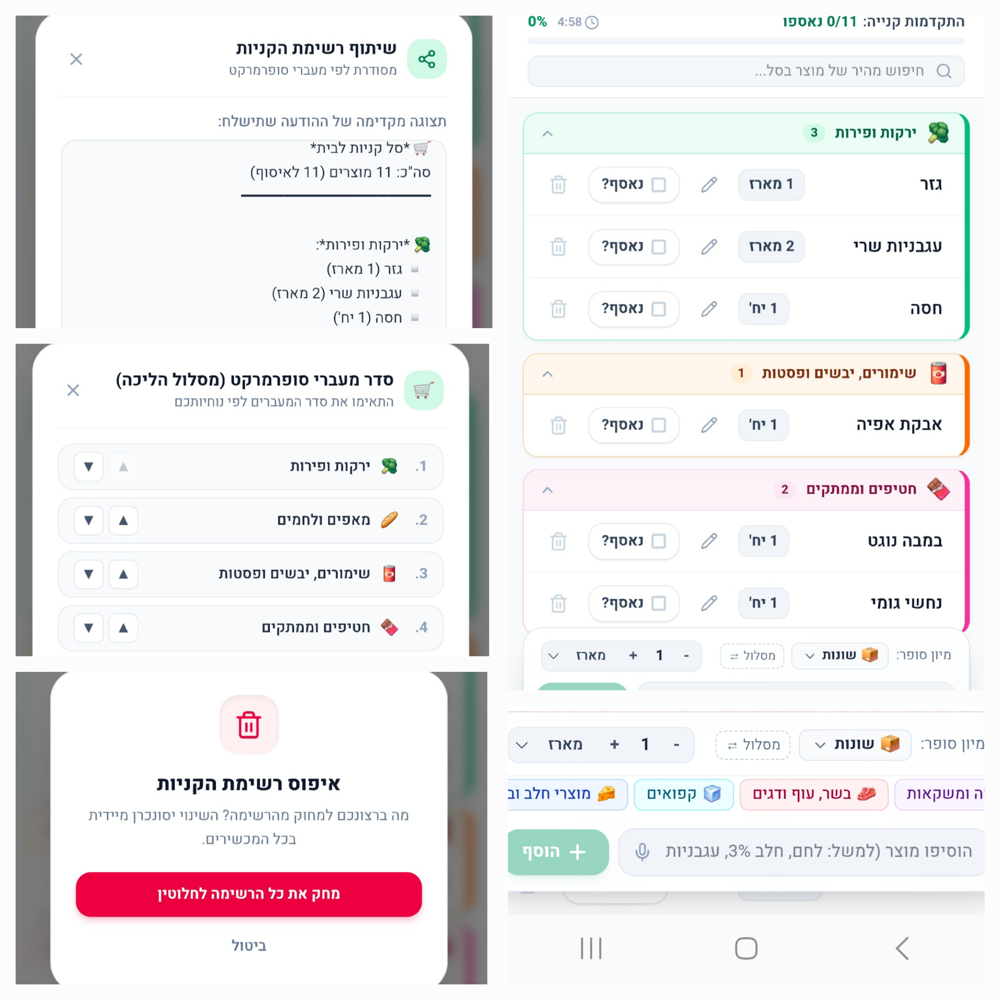

# My Family Groceries App 🛒

A real-time, collaborative family grocery shopping web application designed with a mobile-first UX, optimized for supermarket usage, and built to eliminate friction in household shopping routines.

## 🚀 Key Features
- **Real-Time Cloud Sync:** Powered by Firebase Firestore (`onSnapshot`), ensuring instant, bi-directional synchronization across multiple devices (Android & iOS) without page reloads.
- **Smart Supermarket Aisle Route:** Items are automatically grouped and sorted according to an optimized supermarket walking route (Produce -> Bakery -> Pantry -> Snacks -> Beverages -> Meat -> Frozen -> Dairy -> Cleaning -> General), minimizing backtracking in the store.
- **Canonical Product & Smart Matching Engine:** Uses a structured canonical data model (`canonical`, `aliases`, `category`) to accurately classify typed products while strictly preserving the user's exact input text.
- **Inline Item Editing:** Quick inline modal to edit product names, quantities, and units directly from mobile devices.
- **Security & Session Management:** Protected by a 4-digit family PIN with a 5-minute inactivity session timeout.
- **WhatsApp Integration:** Instant formatting and sharing of the shopping list via WhatsApp.

## 📱 Tech Stack
- **Frontend:** HTML5, Modern JavaScript (ES6+), Tailwind CSS (Mobile-first responsive design).
- **Backend & Database:** Firebase Firestore (Real-time NoSQL database).
- **Tooling & Build:** Vite, Node.js, Firebase Hosting.

## 💡 Designed for Mobile UX
Optimized specifically for the mobile "thumb zone" with sticky floating input bars, high-contrast light mode UI suitable for bright supermarket lighting, and progressive web app (PWA) home-screen support.
